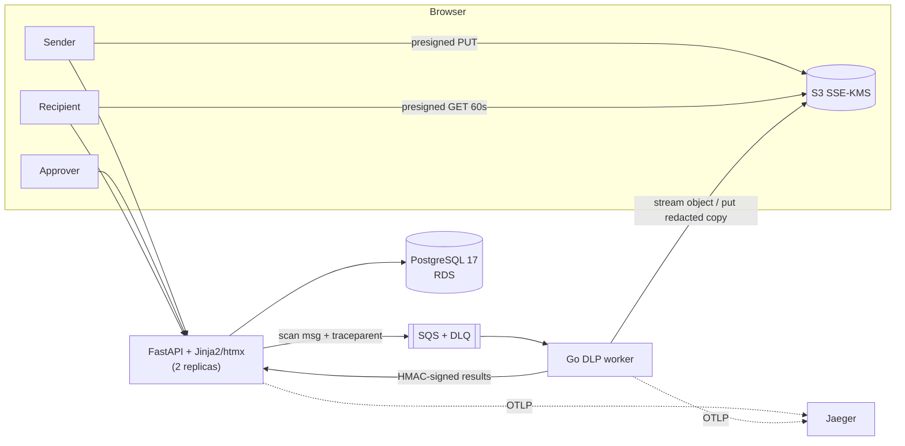

# DLP Secure Transfer

[](https://github.com/mini4141/dlp-secure-transfer/actions/workflows/ci.yml)

High-security enterprise file exchange with data-loss-prevention scanning. Employees send files to external
partners through expiring, password-protected links. Every upload is scanned for PII by a Go worker, risky
transfers need an approver, and recipients only ever get short-lived presigned, KMS-encrypted downloads, all with
an append-only audit trail. It runs on Kubernetes, deployed by ArgoCD, on Terraform-built AWS infrastructure.

**Demo story:** Sam uploads `customers.csv` (fake card numbers) -> the Go worker flags cards, emails and phones ->
Ava reviews obfuscated findings and approves the redacted copy -> the partner downloads it with the password ->
a second download beyond the limit is refused -> the audit log shows every step.

## Architecture



Stack: Python 3.12 / FastAPI / SQLAlchemy 2 async / Alembic / Argon2id / JWT cookie; Go worker (SQS consumer,
detectors with Luhn, My Number and IBAN checks, docx/pdf extraction); Postgres 17; S3 + SQS (moto locally);
Docker, Helm, kind/EKS, ArgoCD; Terraform; GitHub Actions; Prometheus metrics, JSON logs, OpenTelemetry traces.

## Quickstart (local)

Needs Docker, `uv`, Go and Node. Host ports are non-default on purpose (api 18000, postgres 15432, moto 15000,
worker metrics 19090, Jaeger 26686).

```bash
scripts/dev-up.sh        # postgres, moto (S3+SQS), jaeger, migrations, api, worker
# http://localhost:18000  sam@corp.test (sender) / ava@corp.test (approver) / admin@corp.test (admin)
# demo password: demo-password   (local only; cloud uses a random one)
scripts/test-all.sh      # lint + pytest + go test + integration + Playwright
scripts/capture-proof.sh phase1
scripts/drill-worker-crash.sh
scripts/dev-down.sh
```

Kubernetes locally (kind + ArgoCD watching this repo, in-cluster postgres and moto): `scripts/kind-up.sh`
(app on http://localhost:28000), `scripts/kind-down.sh`.

## Deploy / destroy (AWS, from this PC)

```bash
scripts/deploy.sh                                   # terraform apply -> ECR push -> ArgoCD -> app -> e2e + proof
scripts/destroy.sh && scripts/verify-destroyed.sh   # nothing billable may remain
```

Uses only the `dlp-secure-transfer-deployer` profile in `ap-southeast-2`. GitHub Actions never holds AWS credentials;
account-specific values (ECR URLs, RDS endpoint, secrets) are injected as ArgoCD Helm parameters and never committed.

## Layout

`api/` FastAPI app, `worker/` Go worker, `deploy/helm/` chart, `deploy/argocd/` Application template, `infra/` Terraform,
`local/` compose + kind config, `samples/` fake-PII files, `e2e/` Playwright, `scripts/`.

## More

- Proof index (screenshots, logs, test reports): [proof/README.md](proof/README.md)
- Write-up: [docs/PORTFOLIO.md](docs/PORTFOLIO.md)
- Decisions: [docs/DECISIONS.md](docs/DECISIONS.md) · AI usage: [docs/AI_USAGE.md](docs/AI_USAGE.md)
- Spec and rules: [SPECS.md](SPECS.md), [CLAUDE.md](CLAUDE.md) · Progress: [PROGRESS.md](PROGRESS.md)
