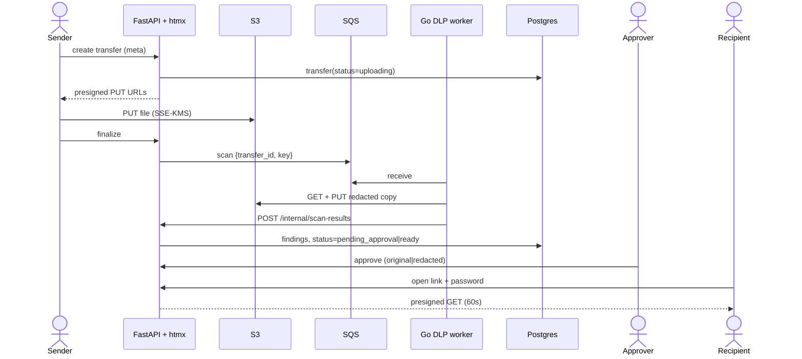

# SPECS.md: DLP Secure Transfer

## 1. Summary

An enterprise **secure file transfer** product with **data-loss prevention**. A sender creates a transfer: files, recipient emails, expiry, a password and a download limit. Files upload straight to S3 (KMS-encrypted). An SQS message triggers a Go DLP scanner that finds PII and produces a redacted copy.

- Transfers that contain PII go to an **approver**, who sees obfuscated findings and decides whether to send the original or the redacted file.
- Clean transfers are released immediately.

Recipients open a link, enter the password and get a short-lived presigned download. Everything lands in an immutable audit log. It deploys to EKS through ArgoCD, on infrastructure built by Terraform.

**Demo story:**
1. Sam uploads `customers.csv`, which contains credit card numbers.
2. DLP flags 3 findings.
3. Ava (the approver) reviews them and approves the redacted version.
4. The partner downloads it with the password.
5. A second download beyond the limit is refused.
6. The audit log shows every step.

## 2. Requirement coverage matrix

| Requirement | Covered by | Proof |
|---|---|---|
| New features with Python + web technologies | FastAPI + Jinja/htmx app | Screenshots |
| Scalable, fault-tolerant services in the cloud | Stateless API pods (2 replicas), SQS + DLQ, worker retries, idempotent scan handling | Drill log |
| Automate deployment, testing, monitoring, documentation via CI/CD + IaC | GitHub Actions, Terraform, ArgoCD, generated OpenAPI docs | CI run, ArgoCD screenshot |
| Containerisation + orchestration (Kubernetes, ArgoCD) | Helm chart, kind/EKS, ArgoCD | kubectl/argocd logs |
| Terraform | `infra/` | Apply logs |
| Mission-critical AWS environments | S3 SSE-KMS, SQS DLQ, RDS, Pod Identity least-privilege, private DB | resources.txt |
| Go (nice to have) | DLP worker | Go tests |
| Cloud security best practices: PII obfuscation, secure data handling | Redaction, obfuscated snippets, presigned TTLs, Argon2, audit | Tests + screenshots |
| Distributed systems / SaaS | API → queue → worker, multi-user RBAC | Trace screenshot |

## 3. Architecture



## 4. Repository layout

```
api/            FastAPI app (app/routers, app/services, app/models, app/templates, alembic/)
worker/         Go DLP worker (cmd/worker, internal/detect, internal/extract)
deploy/helm/dlp-secure-transfer/   chart (api, worker, migrations Job, ServiceMonitor)
deploy/argocd/  application.yaml (templated by deploy script)
infra/          Terraform
local/          docker-compose.yml (postgres, moto, jaeger), kind-config.yaml
samples/        files with fake PII for demos (generated, clearly fake)
scripts/
```

## 5. Features (end-to-end)

### F1: Accounts and roles
- Seeded users: `sam@corp.test` (sender), `ava@corp.test` (approver), `admin@corp.test` (admin). Login form, Argon2id hashes, JWT cookie.
- **Accept:** each role sees its own nav (Send / Approvals / Admin).

### F2: Create transfer and upload
- Form fields: recipients (one or more emails), message, expiry (1–7 days), link password, max downloads, and files (up to 5).
- `POST /api/transfers` creates the transfer and returns presigned PUT URLs. The browser uploads with `fetch`, then `POST /api/transfers/{id}/finalize` enqueues one SQS message per file.
- **Accept:** the transfer appears with status `scanning`.

### F3: DLP scan (Go worker)
- The worker long-polls SQS and extracts text by type. Detectors use regex plus validators:
  - Luhn for cards;
  - the My Number check digit;
  - IBAN mod-97;
  - E.164/JP phone formats;
  - email.
- It produces findings `{type, count, samples (obfuscated), locations}`, uploads `redacted/<key>`, and POSTs the results to the API's internal endpoint (shared HMAC secret). On failure the message returns to the queue; after 3 receives it goes to the DLQ.
- **Accept:** `samples/customers.csv` gives findings for cards, emails and phones, the redacted copy contains `[REDACTED:card]`, and the status becomes `pending_approval`. A clean file goes straight to `ready`.

### F4: Approval workflow
- The approver's queue lists pending transfers. The detail page shows the findings table (obfuscated) and a redacted-text preview. The actions are **Approve original**, **Approve redacted** or **Reject** with a reason.
- **Accept:** after approving the redacted version, the status is `ready` and the release variant is `redacted`.

### F5: Recipient download
- `/t/{token}`: a password form → the file list → each download does a counter check and expiry check, then a 302 to a presigned GET (60 s).
- **Accept:** the first download works, one beyond the limit shows "Download limit reached", and an expired link shows "Expired".

### F6: Audit log and admin dashboard
- The admin page shows counters (transfers by status, findings by type, last 24 h), an audit log table with filters, and CSV export.
- **Accept:** the audit shows created/uploaded/scanned/approved/downloaded events for the demo transfer.

### F7: Resilience drill
- `scripts/drill-worker-crash.sh` kills the worker mid-scan. The message becomes visible again after the visibility timeout, the restarted worker completes the scan, and the scan is processed exactly once in effect (the results endpoint is idempotent by `scan_id`).
- **Accept:** the drill log shows a re-delivery and a single findings row.

## 6. Data model

- `users(id, email, password_hash, role)`
- `transfers(id, sender_id, token, message, password_hash, expires_at, max_downloads, download_count, status, release_variant)`
- `files(id, transfer_id, s3_key, redacted_key, size, content_type, scan_status, scan_id)`
- `findings(id, file_id, type, count, samples jsonb)`
- `approvals(id, transfer_id, approver_id, decision, reason, at)`
- `audit_events(id, actor, action, transfer_id, ip, ua, at)` (append-only)

## 7. Interfaces

- **HTML:** `/login`, `/send`, `/transfers`, `/transfers/{id}`, `/approvals`, `/approvals/{id}`, `/admin`, `/t/{token}`
- **JSON:** `POST /api/transfers`, `POST /api/transfers/{id}/finalize`, `POST /api/approvals/{id}`, `GET /api/audit?format=csv`, `POST /internal/scan-results` (HMAC), `GET /healthz`, `GET /metrics`, `GET /docs`

## 8. Test plan

| Layer | Test |
|---|---|
| pytest | One per F2, F4, F5 and F6, with S3/SQS via moto |
| Go | One per detector, plus extract docx/pdf from fixtures |
| Integration | compose: upload sample → findings stored (polls up to 30 s) |
| e2e | Playwright: Sam sends → Ava approves redacted → recipient downloads |

## 9. Phase 1: Local

Run with `docker compose` (postgres, moto, jaeger, api, worker) for development. Then prove Kubernetes with **kind + ArgoCD**:
- `scripts/kind-up.sh` installs ArgoCD and creates the Application pointing to `deploy/helm` with `values-kind.yaml`.
- moto and postgres run in-cluster.

Checklist:
- [ ] `tests/`: pytest JUnit, go test, Playwright report
- [ ] `screenshots/01-send-form.png`, `02-scanning.png`, `03-approval-findings.png`, `04-redacted-preview.png`, `05-recipient-download.png`, `06-limit-reached.png`, `07-audit-log.png`, `08-argocd-app.png`, `09-trace-api-to-worker.png`
- [ ] `logs/worker-scan.log` (no raw PII), `logs/drill-worker-crash.log`, `logs/kind-get-all.txt`

## 10. Phase 2: AWS

| Local | AWS |
|---|---|
| moto S3/SQS | S3 (SSE-KMS, block public access, versioning on) + SQS + DLQ |
| local Postgres | RDS PostgreSQL db.t4g.micro |
| kind + ArgoCD | EKS + ArgoCD (installed via Helm by the deploy script), same chart with `values-eks.yaml` + injected parameters |
| static creds | EKS Pod Identity roles: api (S3 presign, SQS send), worker (S3 get/put, SQS receive/delete) |

`scripts/deploy.sh`:
1. `terraform apply`.
2. Push images to ECR.
3. Install ArgoCD.
4. Create the Application with parameters.
5. `argocd app wait`.
6. Run migrations (Helm hook Job).
7. Seed.
8. Playwright against the NLB URL.

- [ ] `screenshots/01-eks-approval.png`, `02-eks-download.png`, `03-eks-audit.png`, `04-eks-argocd.png`
- [ ] `logs/s3-head-object-sse.json` (shows `aws:kms`), `logs/sqs-attributes.json`, `logs/terraform-apply.log`, `resources.txt`
- [ ] `tests/playwright-eks/`

## 11. Phase 3: Destroy

`destroy.sh`:
1. Delete the ArgoCD app (cascade) and the LB Service, and wait for the NLB to go.
2. Empty the bucket (all versions).
3. `terraform destroy`.

`verify-destroyed.sh` checks:
- no EKS cluster, RDS instance, SQS queues or S3 bucket;
- the KMS key is pending deletion;
- no ELBs.

## 12. Out of scope

Real email delivery (recipients get the link on screen), SSO/SAML, antivirus, OCR of images, and multi-tenant orgs.
