# DLP Secure Transfer: portfolio write-up

*A high-security file exchange with data-loss-prevention scanning, built end to end: FastAPI + htmx, a Go DLP worker,
SQS/S3, Kubernetes with ArgoCD, and Terraform-built AWS infrastructure that was deployed, proven and destroyed by script.*

Source: this repository. Evidence: [proof/README.md](../proof/README.md).

## The problem

Companies exchange files with partners all the time, and those files are where personal data leaks: a CSV export with
card numbers, a payroll sheet with national IDs. A transfer tool has to be convenient for the sender and still make sure
that (1) nothing sensitive leaves without a human decision, (2) the recipient only gets a short-lived, password-gated
download, and (3) every step is on record.

DLP Secure Transfer does exactly that. A sender creates an expiring, password-protected link. The files go straight to
encrypted S3. A Go worker scans each file for PII and writes a redacted copy. Clean transfers are released
automatically; risky ones wait for an approver who only ever sees **obfuscated** samples and decides between the
original, the redacted copy, or a rejection. Everything lands in an append-only audit log.

## Architecture

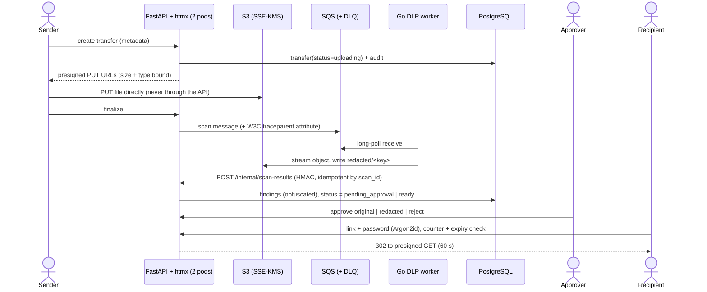

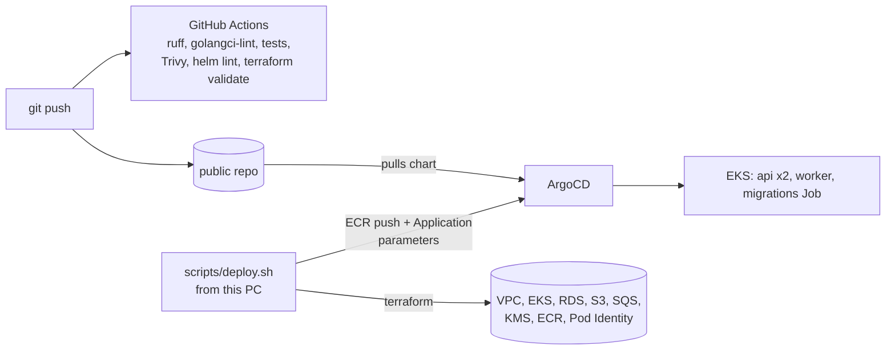

## Requirements -> where they are proven

| Requirement | Stack in this project | Proof |
|---|---|---|
| New features with Python + web technologies | FastAPI, Pydantic v2, SQLAlchemy 2 async + Alembic, Jinja2 + htmx, `uv` | `proof/phase1-local/screenshots/01-07` |
| Scalable, fault-tolerant services | Stateless API (2 replicas), SQS + DLQ (3 receives), worker retries by not deleting the message, idempotent scan results by `scan_id` + unique `(file, type)` | `logs/drill-worker-crash.log` (worker killed mid-scan, redelivered, one findings row) |
| Automate deploy/test/monitoring/docs with CI/CD + IaC | GitHub Actions (lint, tests, image build, Trivy, `helm lint`, `terraform validate`, generated API docs artifact), Terraform, ArgoCD; Prometheus metrics, JSON logs, OpenTelemetry | CI run on `main`, `08-argocd-app.png`, `prometheus-metrics.txt` |
| Containers + orchestration | Docker (multi-stage, non-root), Helm chart, kind locally, EKS in AWS, ArgoCD with sync waves and a migrations hook Job | `kind-get-all.txt`, `phase2-cloud/screenshots/04-eks-argocd.png` |
| Terraform | VPC (public subnets, no NAT), EKS, managed Spot node group, RDS, S3, SQS, KMS, ECR, Pod Identity roles | `phase2-cloud/logs/terraform-apply.log` |
| Mission-critical AWS | S3 SSE-KMS + versioning + public access block + TLS-only policy, SQS DLQ, RDS encrypted and private, least-privilege Pod Identity roles | `s3-head-object-sse.json` (`aws:kms`), `sqs-attributes.json`, `rds-describe.json`, `resources.txt` |
| Go (nice to have) | The DLP worker: SQS consumer, streaming S3 reads, detectors, docx (`archive/zip`) and pdf extraction | `tests/go-test.log` |
| Cloud security best practices | Argon2id, JWT HttpOnly cookie, RBAC, link expiry + download limits, 60 s presigned GET, obfuscated snippets, `[REDACTED:<type>]` copies, no PII in logs, append-only audit via DB grants | `pii-in-logs-check.txt`, `03-approval-findings.png`, pytest audit test |
| Distributed systems / SaaS | API -> queue -> worker with trace context carried in SQS attributes, multi-role workflow | `09-trace-api-to-worker.png` |

## Screenshots

The happy path, captured by Playwright against the running system.

| | |
|---|---|
| 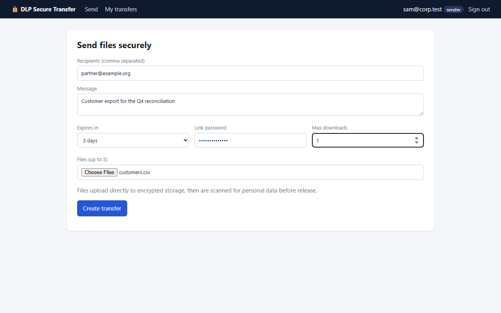 | 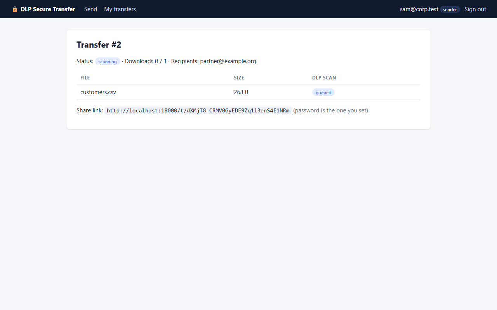 |
|  | 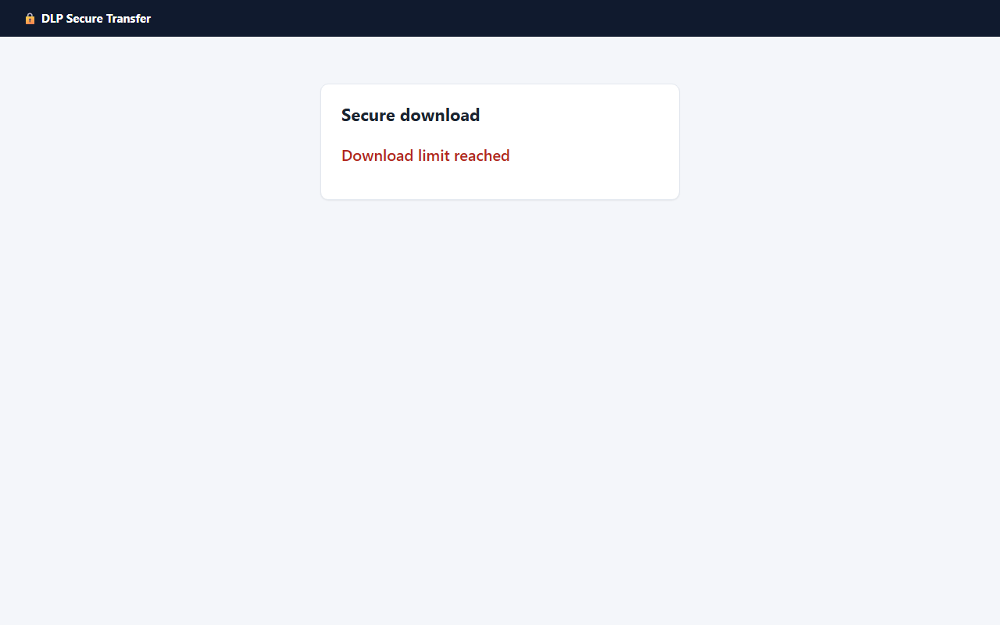 |
| 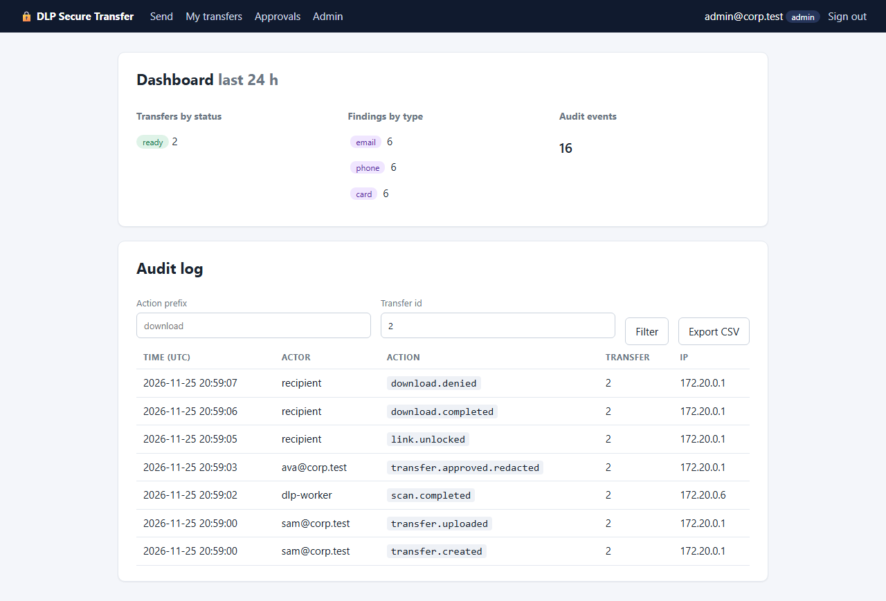 | 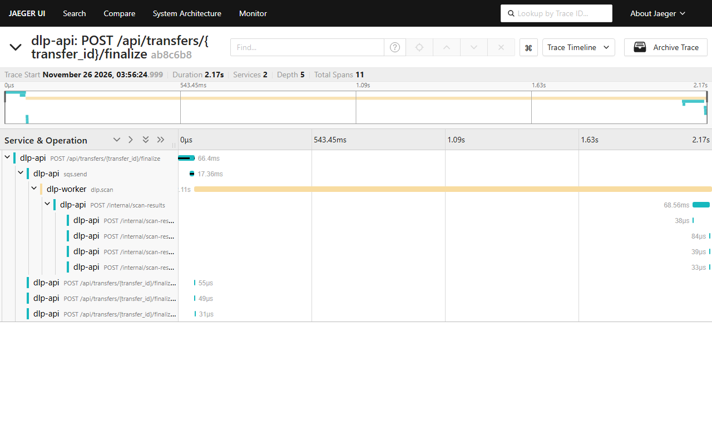 |

On AWS (EKS behind a load balancer, real S3/SQS through Pod Identity):

| | |
|---|---|
| 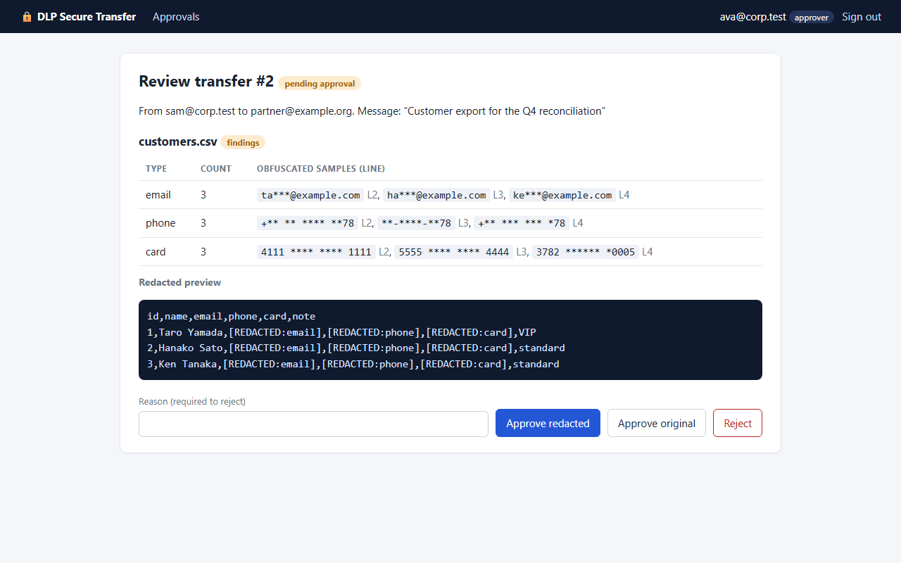 | 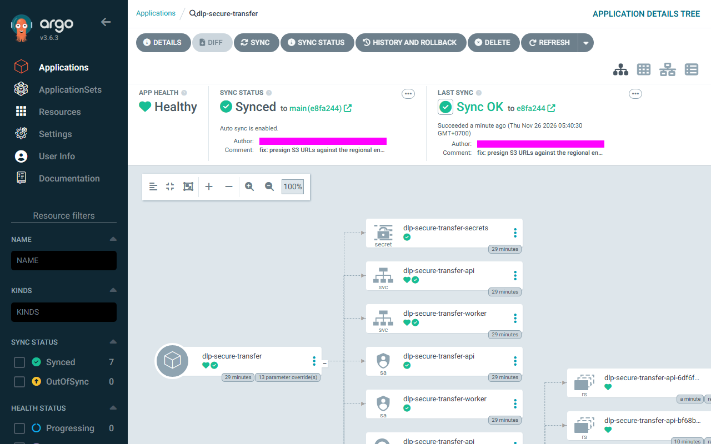 |
| 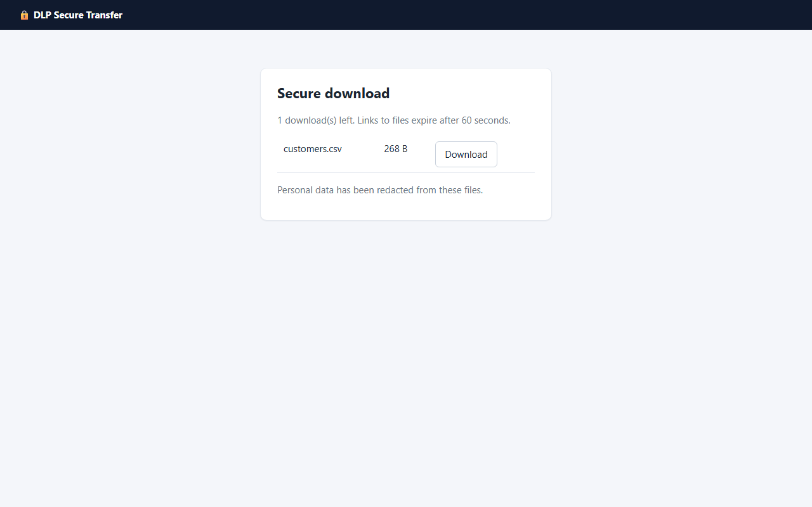 | 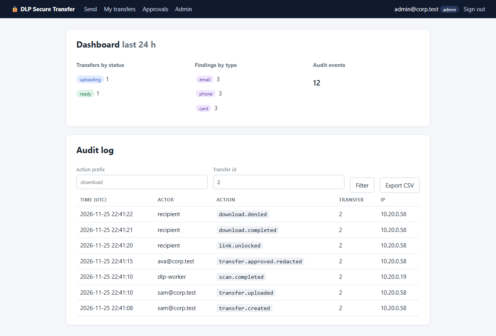 |

## Design decisions worth explaining

- **Data never touches the API pods.** Uploads are presigned PUTs bound to content type and length; downloads are a 302 to
  a 60-second presigned GET issued only after password, expiry and an atomic `UPDATE ... WHERE download_count < max`.
- **The worker never sees a user.** It authenticates to the API with an HMAC over the body. Results are idempotent by
  `scan_id`, so SQS at-least-once delivery is safe, and the DLQ catches poison messages.
- **PII is obfuscated at the source.** The worker sends only masked samples (`4111 **** **** 1111`,
  `ta***@example.com`), so the API, database, logs and UI never hold raw values.
- **Audit is append-only in the database, not by convention.** Migrations create a restricted `dlp_app` role with only
  `SELECT, INSERT` on `audit_events`; a test proves `UPDATE`/`DELETE` fail.
- **GitOps with no secrets in git.** ArgoCD watches the public repo; ECR URLs, the RDS endpoint and random secrets are
  injected as Helm parameters by `deploy.sh`.

## What was hard

- **The cloud fought back in specific ways, each fixed in code:** the AWS account refuses ELBv2 creation
  (`OperationNotPermitted`), so the public endpoint is a Classic ELB; the S3 global endpoint answers `307` for a brand-new
  bucket, which browsers cannot follow for a cross-origin presigned PUT, so URLs are presigned against the regional endpoint;
  the Terraform caller needed an explicit EKS access entry to administer the cluster.
- **A race that only appears with 2 replicas:** both pods seeded the demo users at start-up and one crashed on the unique
  constraint. Found in the kind run, fixed with `INSERT ... ON CONFLICT DO NOTHING`.
- **Supply-chain findings from Trivy in CI** (uv in the runtime image, an alpine openssl update, `golang.org/x/net`) led to a
  multi-stage image and dependency bumps.
- **A one-word bug:** the Application template's comment contained its own `__PARAMETERS__` placeholder, so the renderer
  put the parameter list on line 1. Caught by a server-side dry run.
- **Windows host details:** native tools do not understand `/c/...` paths from Git Bash, another stack already owned the
  default ports, and the ArgoCD screenshot needed masking of the commit author.

## Cost and time

Roughly **USD 0.5 to 1** in total for the cloud phase: the stack lived about an hour (EKS control plane, 2 x `t3.medium`
Spot, `db.t4g.micro`, one classic ELB, no NAT gateway) plus the KMS key's 7-day pending deletion. Terraform apply took
about 15 minutes (EKS and RDS dominate), destroy about 10. `proof/phase3-destroy/verify-destroyed.txt` shows nothing billable left.

## Reproduce

```bash
# local (Docker, uv, Go, Node)
scripts/dev-up.sh && scripts/test-all.sh && scripts/capture-proof.sh phase1
scripts/kind-up.sh                   # kind + ArgoCD on this repo (push your commit first)

# AWS (profile dlp-secure-transfer-deployer, ap-southeast-2; HEAD must be pushed)
scripts/deploy.sh                    # terraform -> ECR -> ArgoCD -> e2e -> proof/phase2-cloud
scripts/destroy.sh && scripts/verify-destroyed.sh
```

All tool choices, deviations (Go 1.26, classic ELB, port choices) and their reasons are in
[docs/DECISIONS.md](DECISIONS.md). How AI tooling was used and verified: [docs/AI_USAGE.md](AI_USAGE.md).
